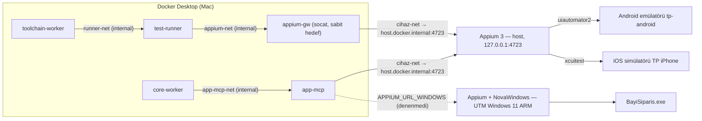

# Mobil ve Masaüstü Test Yeteneği (009)

Web için çalışan hat (gereksinim → case → doğrulama ajanı → şablonla test → PR → kırarak doğrula → CI
→ triage → onarım/bug) aynen **Android, iOS ve Windows masaüstü** uygulamalarına genişletildi. Hat,
insan kapıları, denetim kaydı ve anayasa ilkeleri değişmez; yalnız alttaki sürücü (Appium), üretilen
kodun dili (Java) ve koşum ortamı (cihaz) değişir.

Kaynaklar: plan [`specs/009-mobil-masaustu/plan.md`](../specs/009-mobil-masaustu/plan.md) (bağlayıcı
sözleşmeler §2), cihaz katmanı [CIHAZ-ALTYAPISI.md](CIHAZ-ALTYAPISI.md), CI [`.github/CI.md`](../.github/CI.md)
"Uygulama iş akışları", Windows sanal makinesi [WINDOWS-VM.md](WINDOWS-VM.md).

## 1. Platformlar

| Platform | Demo uygulaması | Otomasyon | Cihaz (yerel) | Cihaz (GitHub CI) |
|---|---|---|---|---|
| `web` | `demo-app/web` (React) | Playwright | — | `ubuntu` Chromium (+ Sauce) |
| `android` | `demo-app/mobile` (Expo / React Native) → `bayi-siparis.apk` | Appium 3 + `uiautomator2` | AVD `tp-android` (arm64, bu Mac) | `ubuntu-24.04` + KVM emülatörü (x86_64) |
| `ios` | aynı Expo kodu → `BayiSiparis.app` (simülatör) | Appium 3 + `xcuitest` | simülatör `TP iPhone` (bu Mac) | `macos-15` simülatörü |
| `windows` | `demo-app/desktop` (WPF, .NET 8) → `BayiSiparis.exe` | Appium 3 + `novawindows` (UI Automation) | UTM içinde Windows 11 ARM (isteğe bağlı, [WINDOWS-VM.md](WINDOWS-VM.md)) | `windows-latest` (x64) |

Üç uygulama da aynı demo API'yi ve aynı ekranları kullanır: giriş, katalog, sepet, sipariş onayı,
siparişlerim. Backend değişikliği yoktur.

Case platformdan bağımsızdır: iş dilinde bir kez yazılır ve onaylanır. Kod üretimi **(case, platform)**
çiftinedir: aynı onaylı case'ten her platform için ayrı script, ayrı dal, ayrı PR çıkar. Varsayılan
`web`'dir (geriye uyum).

## 2. Hat web ile aynı

| Adım | Web | Uygulama (android / ios / windows) |
|---|---|---|
| Kod üretimi isteği | `POST /code/generate {case_ids}` | `POST /code/generate {case_ids, platform}` (başka değer 422) |
| Doğrulama ajanı | `verify_and_map`, Playwright MCP | `verify_and_map_app`, **app-mcp** (Appium) |
| Ajan araçları | `browser_navigate`, `_snapshot`, `_click`, `_type`, `_select_option`, `_wait_for`, `_generate_locator` | `app_launch`, `app_snapshot`, `app_click`, `app_type`, `app_select_option`, `app_wait_for`, `app_generate_locator` |
| Canlı görünüm | `browser_take_screenshot` (model dışı) | `app_screenshot` (model dışı; `FORBIDDEN_TOOLS`'ta) |
| Kütüphane | page object (`demo-app/e2e/pages`) | ekran nesneleri (`demo-app/e2e-app/.../ekranlar`) |
| Sembol tablosu | `tp-symbols` (ts-morph) | `java-araclar symbols` (JavaParser), **aynı şema** |
| Şablon | `rules/templates/playwright_test.ts.j2` | `rules/templates/appium_testng.java.j2` |
| Statik kapı | `tsc --strict`, eslint, ast-guard | `javac` (Maven `test-compile`), `java-araclar guard` |
| Yerel kontrol | test-runner, `--repeat-each=3` | test-runner (Java yolu) → appium-gw → host Appium |
| PR | dal `tp/case-<uuid>` | dal `tp/case-<platform>-<uuid>`, etiket `platform:<platform>`, başlık `[<STORY>-C<n> · <platform>] …` |
| Kırarak doğrula | `BREAK_CAMPAIGN=1` → `/test/break` (bayi kapsamlı) | aynısı; kırmızı adım denetimi `araclar/KirmiziDenetimi.java` (kırmızılar yalnız assertion) |
| Merge kapısı (LocalForge) | `local-ci` | `local-ci-<platform>` (head için kaydedilmiş her biri zorunlu) |
| CI (GitHub) | `ci.yml` → `test-local` | `mobil-android`, `mobil-ios`, `masaustu-windows` |
| Rapor | Playwright JSON + JUnit + Allure | Surefire JUnit XML + Allure (`core/src/tp_core/features/ci/parse.py` JUnit yolu) |
| Triage kanıtı | trace, aria snapshot, ekran görüntüsü | `target/kanit/<Sınıf>.<metot>/{ekran.png,sayfa-kaynagi.xml}` |
| Locator onarımı | yalnız `locators.ts` içindeki `testId` değeri | yalnız `ekranlar/Kimlikler.java` içindeki sabit değeri (`java-araclar locators patch`) |

Değişmeyenler: insan onayları (case, PR, bug), kırarak doğrulama, denetim kaydı (`codegen.*`, `pr.opened`
yükleri `platform` taşır), REPLAY rozeti, CI'da AI olmaması, triage'da önce deterministik kurallar.

## 3. Erişilebilirlik kimliği sözleşmesi

Mobil ve Windows uygulamaları web'deki `data-testid` değerlerinin **aynısını** taşır. Tek liste
`demo-app/kimlikler.json`'dur (web kaynağından üretilir, testlerle kilitlenir). Böylece bir case'in
web ve uygulama scriptleri aynı kimliklerle konuşur ve onarım kuralı tek kalır: **yalnız kimlik değeri
değişir**.

| Platform | Uygulamada | Appium'da |
|---|---|---|
| iOS | RN `testID` → `accessibilityIdentifier` | `AppiumBy.accessibilityId(id)` |
| Android | RN `testID` → `resource-id` (paket öneksiz; oturumda `appium:disableIdLocatorAutocompletion: true`) | `AppiumBy.id(id)` |
| Windows | `AutomationProperties.AutomationId` | `AppiumBy.accessibilityId(id)` |

Platform farkı yalnız `Kimlik.bul(id)` yardımcısındadır; ekran nesneleri platform bilmez. Denetimler:
`demo-app/mobile` → `npm run kimlik-kontrol`, `demo-app/desktop` → `python3 scripts/kimlik-kontrol.py`,
`demo-app/e2e-app` birim testi (`Kimlikler` = web kümesi). Ayrıntı: `demo-app/mobile/README.md`,
`demo-app/desktop/README.md`.

## 4. Üretilen kod: Java 17 + Appium + TestNG

Model Java yazmaz. Ajanın doğruladığı eşlemeden şablon (`appium_testng.java.j2`) dosyayı üretir;
değerler Java literali olarak basılır, beklenen değerler onaylı case metninden gelmek zorundadır.
`java-araclar guard` dosyanın biçimini AST düzeyinde denetler: tek sınıf, tek `@Test` metot, gövdede
yalnız `<erişimci>().<metot>(<literal>, …);` satırları; dal, döngü, lambda, `new`, ham `driver`,
`Thread.sleep`, statik çağrı, Unicode kaçışı yasak (ihlal kodları: `toolchain/java-araclar/README.md`).

Çekirdeğin altın çıktısı (`core/tests/unit/features/codegen/golden/TPD1AndroidC2_3f9b1c2eTest.java`,
REPLAY kipinde `TPD-1 C2` → Android):

```java
// AI-generated — AI Testing Probe (CasesToCode). Elle düzenlemeyin; değişiklik case'in yeniden
// onayı ve yeniden üretimle yapılır.
// Case: TPD-1 C2 (3f9b1c2e-0000-5000-8000-0000000000c2) · Story: TPD-1 · Jira Test: TPD-12
// Onaylı case hash: 945c89ca5f30204174eb8922157a74aa16ea6d05258f1a073abb49005814dffd
// Eşleme: verify_and_map_app · platform: android · mod: replay · bundle: bbbb…bbbb
// Eşleme hash: 46175a46… · şablon: 3c72755b…
package com.antreklabs.bayi.uretilen;

import com.antreklabs.bayi.altyapi.Bayi;
import com.antreklabs.bayi.altyapi.TestTabani;
import org.testng.annotations.Test;

@Bayi("bayi1")
public class TPD1AndroidC2_3f9b1c2eTest extends TestTabani {
  @Test(groups = {"uretilen", "android", "tp-case-3f9b1c2e-0000-5000-8000-0000000000c2", "TPD-1"}, description = "7 adet kampanyalı üründe 1 adet bedava verilir")
  public void senaryo() {
    // S1 — Giriş sayfasını aç
    girisEkrani().ac();
    // S2 — Bayi kullanıcısıyla giriş yap
    girisEkrani().girisYap("bayi1", "Demo123!");
    // S3 — "Portakal Gazozu 1L" (P-001) kartında adedi 7 yapıp "Sepete ekle" butonuna bas
    katalogEkrani().sepeteEkle("P-001", 7);
    // S4 — Üst menüden sepete git
    katalogEkrani().sepetiAc();
    // Beklenen sonuç (değerler onaylı case metninden)
    sepetEkrani().dogrulaSatirAdedi("P-001", 7);
    sepetEkrani().dogrulaBedavaAdet("P-001", 1);
    sepetEkrani().dogrulaAraToplam("175,00 TL");
    sepetEkrani().dogrulaIndirim("25,00 TL");
    sepetEkrani().dogrulaToplam("150,00 TL");
  }
}
```

(Başlıktaki uzun hash'ler burada kısaltıldı.) Dosya yolu
`demo-app/e2e-app/src/test/java/com/antreklabs/bayi/uretilen/<Story><Platform>C<n>_<uuid8>Test.java`;
platform adı dosya adında olduğu için aynı case'in platform scriptleri çakışmaz. TestNG grupları
`{"uretilen", "<platform>", "tp-case-<uuid>", "<story>"}`: CI bir platform koşusunda yalnız o platformun
üretilen testlerini `-Dgroups` ile seçebilir. Parola, web scriptindeki gibi sentetik demo bayisinin
yayımlanmış parolasıdır (`demo-app/README.md`).

Java test projesi: `demo-app/e2e-app/` (Maven sarmalayıcısı, `testng.xml`, `altyapi/`, `ekranlar/`,
`testler/` elle yazılmış referans testler, `uretilen/`). Ayrıntı: `demo-app/e2e-app/README.md`.

## 5. app-mcp: doğrulama ajanının aracı

`toolchain/app-mcp/` — kendi MCP sunucumuz (Node 22 + TypeScript, streamable HTTP, Appium'a
WebdriverIO ile bağlanır). Araç yüzeyi kapalı bir listedir ve argüman adları Playwright MCP eşleriyle
aynıdır:

| Araç | Ne yapar |
|---|---|
| `app_launch` | `platform` alır; **yapılandırılmış** uygulamayı sıfırdan başlatır (ajan uygulama seçemez) |
| `app_snapshot` | Sadeleştirilmiş erişilebilirlik ağacı, satırlarda `[id=…]` ve `[ref=eN]` |
| `app_click` · `app_type` · `app_select_option` | `ref` ile eylem; parola alanının metni hiçbir çıktıda görünmez (`***`) |
| `app_wait_for` | Metin göründü/kayboldu ya da süre (üst sınır `APP_MCP_WAIT_MAX_S`) |
| `app_generate_locator` | `ref` → `{"platform","strategy","id"}`; çekirdek locator çapraz kontrolünü bundan yapar |
| `app_screenshot` | Yalnız çekirdeğin canlı görünüm kanalı; ajanın izin listesinde yok, geçitte `FORBIDDEN_TOOLS` |

**Yok:** kod/script çalıştırma, `mobile:*` / `execute`, uygulama kurma/kaldırma, dosya push/pull,
serbest XPath, ham sayfa kaynağı dökümü.

**Neden hazır bir Appium MCP değil (anayasa V):** hazır Appium MCP sunucuları ekran görüntüsü, kod
çalıştırma ve dosya araçlarını kapatılamaz biçimde açar. İlke V ("uygulamayı gerçekten gör") ajanın
uygulamayı canlı sürmesini ister, ama ajan ekran görüntüsü görmez ve etkili eylemi olmaz. Bunu
geçitteki izin listesi (`ALLOWED_AGENT_TOOLS['verify_and_map_app']`) ile birlikte güvence altına almak
için yüzeyin bizim kontrolümüzde ve dar olması gerekir. Snapshot biçimi Playwright MCP'ninkine
benzer olduğundan çekirdeğin ref/snapshot ayrıştırıcıları ortaktır.

Snapshot örneği (Bayi giriş ekranı, elle yazılmış iOS fikstürü; `docs/CIHAZ-ALTYAPISI.md` §6.2):

```yaml
- heading "Bayi Sipariş Portalı" [ref=e1]
- textbox "Kullanıcı adı" [id=login-username] [ref=e2]: bayi3
- textbox "Parola" [id=login-password] [password] [ref=e3]: ***
- button "Giriş yap" [id=login-submit] [ref=e5]
```

Yapılandırma, oturum yaşam döngüsü, cihaz kilidi ve testler: [CIHAZ-ALTYAPISI.md §6](CIHAZ-ALTYAPISI.md).

## 6. Koşum topolojisi



- `app-mcp` ve `appium-gw` compose `mobil` profilindedir; varsayılan `make up` yığınına girmez:
  `docker compose --profile mobil up -d app-mcp appium-gw`. Hosta port açılmaz.
- Appium hostta `127.0.0.1:4723`'e bağlıdır; konteynerler Docker Desktop'ın `host.docker.internal`
  vekiliyle ulaşır, LAN ulaşamaz (`make cihaz-ag` doğrular).
- test-runner internal ağlarda kalır; hosta tek çıkışı `appium-gw`'dir (yalnız
  `host.docker.internal:4723`). Kalan risk (Appium API'sinin kendisi) [CIHAZ-ALTYAPISI.md §5.1](CIHAZ-ALTYAPISI.md)'de.
- Uygulama demo API'ye Android'de `10.0.2.2:8081`, iOS'ta `127.0.0.1:8081` (compose `demo-app-web`
  nginx'i, `/api/*`) üzerinden gider. Testlerin `/test/*` çağrıları test-runner'dan doğrudan
  `demo-app-api:8000`'e gider.
- Windows için test-runner yönlendiricisi yoktur (`TP_RUNNER_APPIUM_URL_WINDOWS` boş): Windows Java
  koşusu yerel kontrolde sağlık adımında `error` döner. Windows yerelde yalnız app-mcp (ajan) ve
  hosttan elle Java koşusu için düşünülmüştür.

Cihaz hazırlığı: `make cihaz-kur` (bir kez), `make cihaz-baslat PLATFORM=android|ios`, `make cihaz-durum`,
`make cihaz-durdur`, `make cihaz-wda` (iOS), `make cihaz-ag`.

## 7. CI matrisi

| | Yerel (LocalForge, `TP_FORGE=local`) | GitHub (`TP_FORGE=github`) |
|---|---|---|
| Kim koşturur | toolchain-worker `/check` (`lang:"java"`, `platform`) → test-runner `toolchain/runner/java_run.py` | demo deposundaki iş akışı → `demo-app/ci/run-app-checks.sh <platform>` |
| Cihaz | bu Mac'teki emülatör/simülatör (appium-gw üzerinden) | runner'ın emülatörü / simülatörü / Windows masaüstü |
| Kontrol adı | `local-ci-android`, `local-ci-ios`, `local-ci-windows` | `mobil-android`, `mobil-ios`, `masaustu-windows` |
| Zorunluluk | head için kaydedilmiş her `local-ci-<platform>` zorunlu; yalnız `e2e-app/` değiştiren PR en az bir platform kontrolü ister | platform etkinleştirilince job adı hem `TP_REQUIRED_CHECKS`'e hem ruleset'e (`scripts/github-ruleset.sh --checks …`) eklenir; `mobil-ios` varsayılan olarak zorunlu değil (yol süzgeçli, pahalı macOS dakikası) |
| Windows | desteklenmez (yönlendirici yok) | `masaustu-windows`, `windows-latest` x64 |
| Artefakt | `runs/<id>/` (Surefire özeti, `junit.xml`, Allure, kanıt) | `<job>-results`: `ci-meta.json`, `surefire-reports/`, `allure-results/`, `kanit/`, `logs/` |

Her iki kipte de CI'da AI yoktur: app-mcp, model anahtarı ve ajan yalnız kod üretiminde (core-worker)
kullanılır.

## 8. Sınırlar ve kanıt durumu

Bu bölüm 2026-11-09 itibarıyla `feat/mobil-masaustu` dalının durumudur.

| Konu | Durum | Kanıt / not |
|---|---|---|
| Android uygulaması (derleme, ekranlar, kimlikler) | **Kanıtlandı** | Android 16 emülatöründe elle yürütüldü; 39 kimliğin 37'si ağaçta (`demo-app/mobile/README.md` "Doğrulama") |
| Android Java referans testleri | **Kanıtlandı** | emülatörde uçtan uca yeşil (öneksiz `resource-id`, APK kurulumu, kaydırma düzeltmeleri) |
| app-mcp Android | **Kanıtlandı** | `duman.mjs android` (stok Ayarlar), konteynerdeki app-mcp'ye karşı da; `duman-demo.mjs android` Bayi uygulamasında giriş + `add-to-cart` locator'ı |
| test-runner → appium-gw → Appium | **Kanıtlandı (ağ)** | yalıtılmış yığında `appium-gw:4723` açık, internet/host diğer portlar kapalı ([CIHAZ-ALTYAPISI.md §5.1](CIHAZ-ALTYAPISI.md)) |
| Android REPLAY golden'ı (`verify_and_map_app/golden/TPD-1-C2-android`) | **Sözleşmeden yazıldı** | araç adımları app-mcp sözleşmesine göre elle hazırlandı, canlı cihazda kaydedilmedi (`rules/evaluations.yaml`) |
| `verify_and_map_app` canlı model değerlendirmesi | **Bekliyor** | `rules/evaluations.yaml` → `verify-and-map-app: status: pending` |
| iOS uygulaması | Elle yürütüldü | iOS 18.5 simülatöründe aynı akış elle doğrulandı |
| iOS Appium (xcuitest) oturumu | **Bu Mac'te engelli** | Xcode 26+ ile xcuitest, Appium'u başlatan uygulamanın macOS gizlilik iznini (Uygulama Yönetimi / Tam Disk Erişimi) bekleyip asılı kalıyor; izin verilene dek iOS Java koşusu ve app-mcp iOS dumanı yapılamıyor ([CIHAZ-ALTYAPISI.md §7](CIHAZ-ALTYAPISI.md)) |
| Windows uygulaması | **Yalnız derlendi** | macOS'ta `EnableWindowsTargeting` ile derleniyor, çekirdek testleri geçiyor; hiç Windows'ta çalıştırılmadı |
| Windows CI (`masaustu-windows.yml`) | **Yazıldı, koşturulmadı** | yalnız `actionlint` + YAML ayrıştırma |
| Windows VM (UTM) | **Kurulmadı** | rehber: [WINDOWS-VM.md](WINDOWS-VM.md); app-mcp Windows snapshot fikstürü elle yazıldı, NovaWindows öznitelik adları gerçek kaynakla doğrulanmalı |
| GitHub mobil iş akışları (`mobil-android`, `mobil-ios`) | **Yazıldı, koşturulmadı** | emülatör/simülatör açılış süreleri, runner Xcode'unun Expo SDK 58 / RN 0.88 yeterliliği doğrulanmadı |
| Kod üretimi Android uçtan uca (case → ajan → PR → kırarak doğrula → merge) | **Koşturulmadı** | çekirdek yolu birim/sözleşme testli (`core/tests/unit/features/codegen/test_platform.py`, altın Java çıktısı); canlı yığında prova yapılmadı ([MOBIL-DEMO-EKI.md](MOBIL-DEMO-EKI.md) "Hazır mı") |
| PR CI'ında `local-ci-<platform>` kaydı | **Bağlantı eksik** | toolchain-worker `/check` (`lang:"java"`) kaydı yazabiliyor ve LocalForge kapısı onu istiyor, ama çekirdeğin PR CI tetiği (`core/src/tp_core/features/ci/service.py` `enqueue_ci`) henüz platformu iletmiyor (plan §2.9 beklentisi): Android PR'ında web paketi koşar, `local-ci-android` oluşmaz |
| Java onarım ve triage yolu | Birim testli | `core/tests/unit/features/repair/test_java_flow.py`, `core/tests/unit/features/triage/test_java.py`; canlı kırılma demosu yapılmadı |
| Portal platform seçimi | Ayrı şerit (Ş7) | "Kod üret"te platform seçimi, rozet, Kontrol Kulesi süzgeci |

Bilinen sınırlar:

- Platform başına tek cihaz: app-mcp aynı anda bir MCP oturumunun bir platformu sürmesine izin verir.
- Aynı demo API'ye karşı web e2e ile uygulama e2e'si aynı anda koşturulmaz (bayi kilitleri ortak değil).
- Gerçek cihaz (fiziksel telefon) ve bulut cihaz çiftliği kapsam dışıdır; CI emülatör/simülatör kullanır.
- `.env.example` henüz mobil değişkenlerini (`APPIUM_URL_*`, `APP_WINDOWS_APP`, `TP_RUNNER_APPIUM_URL_*`)
  listelemiyor; varsayılanlar `docker-compose.yml`'dadır.
